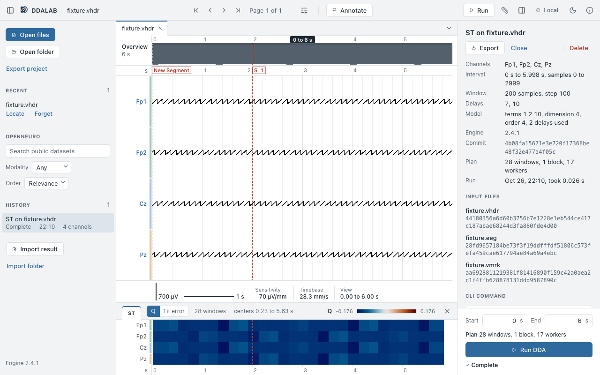
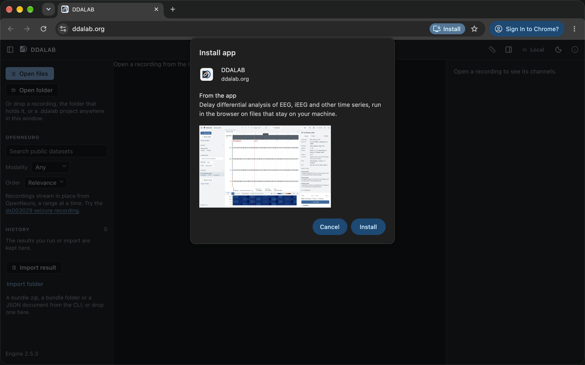
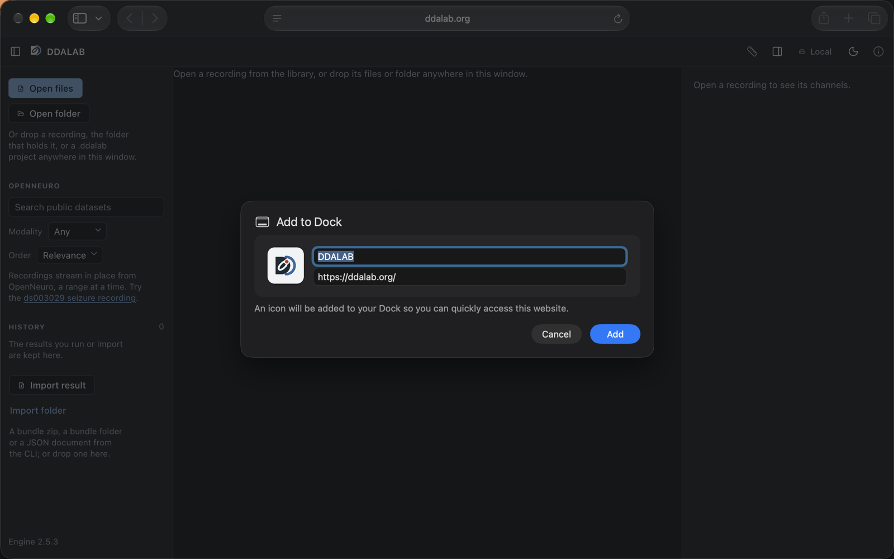

#  DDALAB: Delay Differential Analysis Laboratory

DDALAB runs Delay Differential Analysis (DDA) on EEG, iEEG and other recordings. Open it at **<https://ddalab.org/>**: it runs in your browser and reads your recordings in place, without uploading them. The `ddalab` command runs the same engine for batch and GPU work.



## Use it in the browser

Open <https://ddalab.org/> in Chrome, Edge, Firefox or Safari. Choose Open files or Open folder, or drop recordings onto the window. DDALAB reads EDF, BDF, BrainVision, EEGLAB (.set) and delimited text (CSV, TXT, ASCII), and it streams public EEG and iEEG datasets from OpenNeuro. Results stay in your browser and export as bundles, JSON or CSV.

The [guide](guide/README.md) covers OpenNeuro, shared projects, windows, updates and hosting the app yourself.

## Install the app

Installing is optional. The installed app opens in its own window, starts from the Dock or the Start menu, and works offline after its first launch. It updates itself.

### Chrome or Edge on a computer

Click Install in the address bar (in Edge, App available), then Install.



If the button does not show, open the ⋮ menu and choose Cast, save, and share, then Install DDALAB. In Edge, open the ⋯ menu and choose Apps, then Install DDALAB.

### Safari on a Mac (macOS 14 or later)

Choose File, then Add to Dock, then Add.



### iPhone and iPad

Open ddalab.org in Safari, tap the Share button, then Add to Home Screen, then Add.

### Android

Open ddalab.org in Chrome, tap ⋮, then Install app (Add to Home screen on some phones).

Firefox has no desktop install; bookmark the address instead. To remove the app, choose Uninstall DDALAB in the app window's menu in Chrome or Edge, or remove it from the Dock and the Applications folder on a Mac.

## Command line and Python

`ddalab` is the same engine as a native program. It adds NVIDIA GPUs (`--device cuda` on Linux) and the CCD variants. It needs Python 3.9 or later:

```sh
uv tool install ddalab      # or: pipx install ddalab, or: pip install ddalab
ddalab run --file recording.edf --variants ST --wl 1000 --ws 200 --delays 7 10 --bundle out
```

Without Python, use `brew install sdraeger/tap/ddalab`, Scoop, the installers or the archives on the [release page](https://github.com/sdraeger/DDALAB/releases); the [guide](guide/README.md#command-line) lists each. The same install is a Python library:

```python
import ddalab

result = ddalab.run("sub-01_eeg.edf", variants=["ST"], wl=200, ws=100)
result.variants["ST"].q     # NumPy array, (channels, windows)
```

For BIDS datasets, `ghcr.io/sdraeger/ddalab` is a [BIDS App](guide/README.md#container-bids-app).

## Repository layout

- `packages/dda-rs`: the Rust core (engine, readers, tiles, block runner, result documents) and the `ddalab` CLI (`dda_rs::cli`).
- `packages/ddalab-cli`: the `ddalab` binary that the release archives and installers carry.
- `packages/ddalab-py`: the PyPI wheel, the engine for Python (`ddalab._core`, PyO3) and the `ddalab` command.
- `packages/ddalab-wasm`: `dda-rs` compiled to `wasm32-unknown-unknown` with a plain `extern "C"` ABI.
- `packages/ddalab-web`: the React and TypeScript web application.

## Development

Prerequisites: stable Rust with the `wasm32-unknown-unknown` target, and Node.js 26.

```bash
sh packages/dda-rs/scripts/check-wasm.sh    # wasm library and ABI build, cargo test --release, ABI Node tests
cd packages/ddalab-web && npm ci && npm run dev
```

`npm run build`, `npm test`, and `npm run test:e2e` build the wasm module first.

A release is a `v*` tag. The tag must equal the version of every package and of `CITATION.cff` (`scripts/check-versions.sh`), or the release workflows fail; pre-release tags (a `-` in the tag) are not published to the site. `.github/workflows/release.yml`, generated by [cargo-dist](https://github.com/axodotdev/cargo-dist) from `dist-workspace.toml`, builds the CLI archives, installers and Homebrew formula and creates the GitHub release; `pypi.yml` builds and publishes the wheels; `web.yml` deploys the site and attaches the web bundle. Each records the commit in every result document (`reproduction.git_commit`). After changing `dist-workspace.toml`, run `dist generate`.

## Citation

[`CITATION.cff`](CITATION.cff) holds the citation; GitHub's "Cite this repository" offers it as APA and BibTeX.

```bibtex
@software{draeger-ddalab-2025,
  author = {Dr{\"a}ger, Simon and Lainscsek, Claudia and Sejnowski, Terrence J},
  title = {DDALAB: Delay Differential Analysis Laboratory},
  year = {2025},
  url = {https://github.com/sdraeger/DDALAB}
}
```

## Acknowledgments

Developed with support from **NIH grant 1RF1MH132664-01**.

> **Disclaimer:** DDALAB is a research tool. Users are responsible for validating results against established standards for their specific applications.
